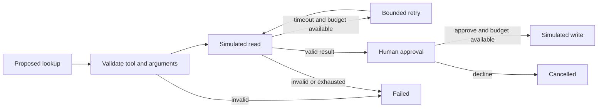

# Agent Replay

**Watch the workflow. Understand where it breaks.**

An interactive teaching lab for agent orchestration: proposed tool calls, argument validation, result validation, bounded retries, tool-call budgets, and human approval. Step through each transition, inspect the trace, and export it as JSON.

Every scenario is a deterministic simulation. There is no LLM, external tool execution, or actual publication. This project explores the application logic that would surround a model-powered agent.

## Try it locally

Requires Python 3 for a static server. No packages, credentials, or API key needed:

```sh
git clone https://github.com/vaidveena/agent-replay.git
cd agent-replay
python3 -m http.server 4190 --bind 127.0.0.1
```

Open **http://127.0.0.1:4190**. Choose a scenario and click **Step forward** or **Run to next pause**. A successful lookup pauses for approval; approve and advance again to simulate publication, or decline to cancel.

Changing the scenario or budgets resets the experiment. Exporting saves a JSON snapshot of the current trace; importing or resuming exported traces is not supported.

## Six experiments

| Scenario | What to observe |
| --- | --- |
| Happy path | Lookup validation, explicit approval, and simulated publication |
| One timeout, then recovery | A retry succeeds within the budget |
| Service stays unavailable | Retry exhaustion stops execution |
| Malformed arguments | The call is rejected before tool execution |
| Malformed result | A tool can return data that should not be used |
| Tool outside the allowlist | A proposal does not authorize execution |

Try a **one-call budget** on the happy path. The lookup succeeds, but even human approval cannot bypass the exhausted budget for the simulated write. On the recovery scenario, a two-call budget permits both lookup attempts but leaves no call for publication.

## How the engine works



`transition` is a state transition function: it receives the previous snapshot and an action, then returns the next snapshot without mutating the previous one. States describe the current workflow position; trace events explain how it got there.

`runUntilPause` advances the same transitions until approval or a terminal state. It cannot grant approval. The engine limits each run to 1–5 tool calls and 0–2 retries. Each attempted lookup and the simulated write consumes one call. Validation, planning, and approval consume none.

The input contract permits only `lookup_ticket` with a single `DEMO-<number>` identifier. Successful output must contain exactly a supported status and a consistent nonnegative integer blocker count. Timeouts are scripted failures; retries are immediate simulation steps, not real backoff or network calls.

## Test and evaluate

Requires Node.js 20+; no installation needed:

```sh
npm test
npm run eval
```

Tests cover approval boundaries, cancellation, budget exhaustion, retries, contract rejection, immutable snapshots, and JSON export. A configuration sweep checks every scenario with all supported budget combinations. The six-case evaluation checks scripted outcomes and tool-call counts. These checks validate the simulator, not an LLM’s judgment or a production agent’s reliability.

## Project map

- `engine.js`: scenarios, contracts, transitions, pause behavior, and export.
- `app.js`: controls, trace rendering, and download.
- `index.html`, `style.css`: responsive lab interface.
- `test/engine.test.js`: engine invariants and failure cases.
- `evaluate.js`: readable scenario outcome checks.

## Privacy and limitations

The interface uses fictional fixture data, keeps the run in browser memory, and makes no application API calls. Refreshing clears the run. The static server only serves assets; if hosted elsewhere, ordinary hosting logs may record requests.

This is not a production authorization system. State is inspectable and modifiable in browser developer tools. A real application would enforce permissions and budgets on a trusted server, validate live tool data, manage timeouts and backoff, and protect credentials. This lab has no model-driven planning, persistent execution, concurrent tools, or live services.

## Learning in public

This follows my response-evaluation and retrieval experiments with a closer look at orchestration. See [the build note](LEARNING.md) for the design choices and next experiment.

**Next:** connect a model to proposed-call generation while keeping validation, approval, and budgets enforced by application code. Evaluate whether model-generated calls satisfy the same contracts.

## Contributing and license

Contribute fictional failure scenarios, reproducible invariant failures, or accessibility improvements. Do not include credentials or confidential traces. MIT licensed; see [LICENSE](LICENSE).
